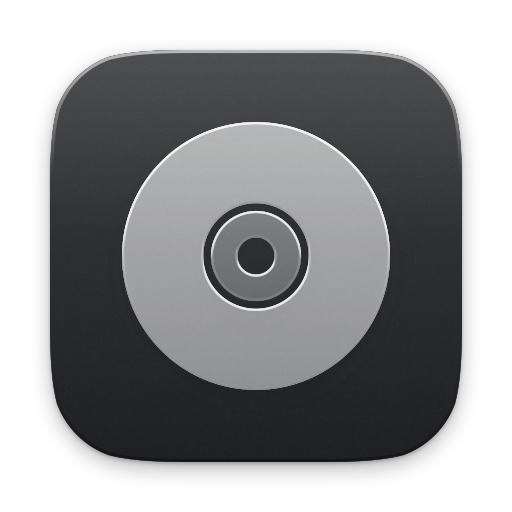

# CD

CD plays an album the way a CD player does: you drop in a folder, the cover appears on a disc, and the music plays from the first track to the last with nothing in between, not even a millisecond of silence.

## How it works

1. **Put a CD in.** Drop a folder of music on the window or the Dock icon, click the disc, use ⌘O, or *Open With › CD* in Finder. Folders are searched inside too (multi-disc albums). FLAC, WAV, AIFF, ALAC and AAC (M4A), MP3, CAF and the other formats macOS can read.
2. **Order.** Tracks are sorted by disc and track number from their tags (by file name when there are none). The cover comes from the files, or from an image in the folder (`cover.jpg`, `folder.jpg`…). Below the disc: album, artist, year, number of tracks, length and format; while it plays, the track's title takes the first line and the album moves before the artist.
3. **Play.** Press ▶ or click the CD (again to pause). The disc spins up and keeps turning while the music plays; the queue opens on the right, taking the room the window has and widening it only if needed. Hover a track and click the ▶ that replaces its number to play it; drag tracks to reorder them. The playing track is tinted in the CD's colour.
4. **Change CD.** Move the pointer near the still CD: it lifts off the window (a shadow fades in, it grows slightly) and two buttons appear in the corners of its square: ⟳ opens another folder, × takes the CD out. With no CD in, a folder button opens one. The old CD slides out to the left over its housing, the frosted disc that stays in place, and the new one rises from below.
5. **Colour.** The accent colour (volume slider, playing track, buttons) comes from the cover, adjusted to stay readable in light and dark mode.

### Controls

| | Title bar | Keyboard |
| --- | --- | --- |
| Volume | slider on the left (full = the normal level) | |
| Previous track | ⏪ (back to the start of the track if it has played for more than 3 s) | ⌘← |
| Play / Pause | ▶ / ⏸ | Space |
| Next track | ⏩ | ⌘→ |
| Stop | ■ | ⌘. |

The media keys on the keyboard and the Now Playing controls in Control Center are supported too, with the cover and the track shown there.

## Gapless playback

The whole album is played as **one continuous stream**. A decoder thread reads the tracks one after the other and writes their samples back to back into a ring buffer; the audio output only copies samples out of it. There is no player per track and nothing to schedule, so the last sample of a track is followed by the first sample of the next one in the same audio cycle: no gap, no click.

- **Exact.** The output is identical, sample for sample, to each file decoded on its own and joined together (tested with a continuous tone split into tracks, in WAV, FLAC, ALAC, AAC and MP3). The encoder delay and padding of AAC and MP3 files are removed as their headers say. When the output device runs at another sample rate, one converter handles the whole album, without restarting between tracks.
- **Light.** The album is never loaded into memory: files are streamed from disk, about 20 seconds of audio are kept ready (8 MB at 44.1 kHz). Playing takes 1–2 % of the CPU.
- **Slow disks.** A separate thread reads the current file well ahead of the music and the beginning of the next file into the system's file cache, so a slow external disk, or one that is still spinning up, is never waited on at a track change. Play and skip wait until 1.5 s of audio is ready, so a slow disk delays the start instead of stuttering. Tested with heavy 24-bit/96 kHz WAV files on a simulated disk of 0.8 MB/s with 5 s of latency on every file: no dropouts.
- **Reordering.** Moving tracks while music plays re-reads only what no longer follows the track you hear.

## Requirements

macOS 15 Sequoia or later, Apple Silicon. CD is not notarized: the first time, open System Settings › Privacy & Security and click **Open Anyway**. Nothing goes online.

## Build

```bash
scripts/setup-signing.sh     # once: a local signing identity in signing/ (not in the repository)
scripts/build-app.sh         # build, sign, install in /Applications and launch
scripts/make-dmg.sh          # build/CD-<version>.dmg
```

`NO_INSTALL=1 scripts/build-app.sh` only builds `build/CD.app`; `ADHOC=1` signs ad hoc.

## Testing

```bash
swift build
.build/debug/CD --render OUT.wav [--rate 48000] [--reorder-at SECONDS] FOLDER
```

plays the album through the real engine offline and writes what the speakers would get, to check the junctions between tracks. The app also reads a few environment variables for tests (all in `Sources/CD/Snapshots.swift`): `CD_OPEN`, `CD_MUTE=1`, `CD_ACTIONS="2:play,5:skip,…"`, `CD_STATS` (memory, CPU, dropouts and track every second), `CD_SNAPSHOT`, `CD_SLOWDISK="MBps:seconds"` (simulated slow disk).

## Known limits

- An album that mixes sample rates (some tracks at 44.1 kHz, some at 48 kHz) gets a very faint resampler transient (−37 dB) at the track where the rate changes. No gap.
- AAC and MP3 tracks that were encoded separately can carry small artefacts at their edges from the encoder itself; CD plays exactly what the files contain.
- A disk only just faster than the music itself (for example 0.65 MB/s for a 24-bit/96 kHz WAV, which needs 0.55 MB/s), with seconds of latency on every file, can still run dry at a track change.

## License

MIT.
